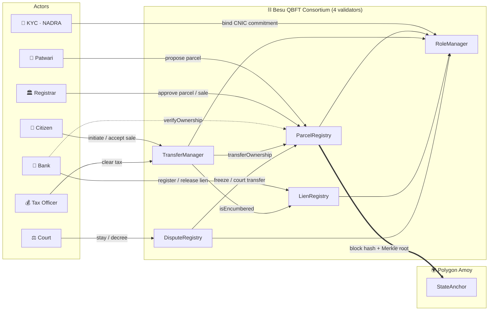
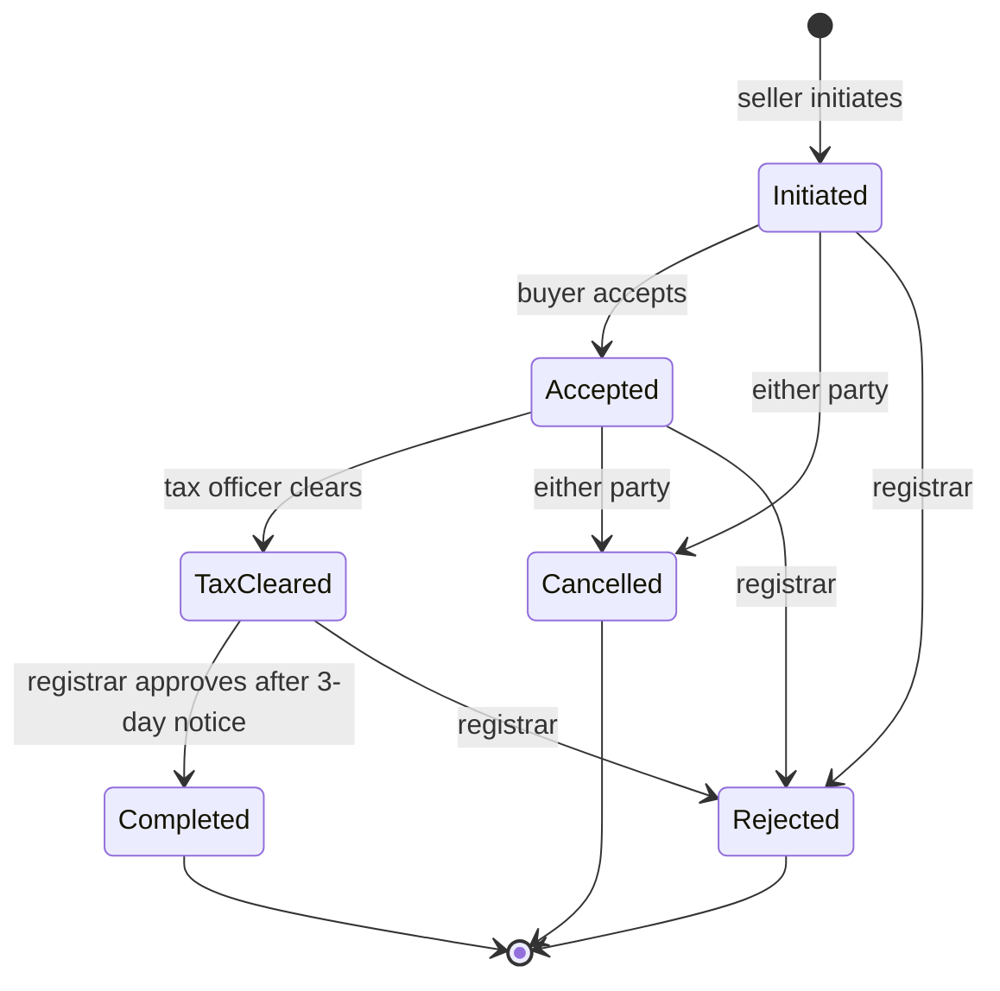

<div align="center">

# 🏛️ LandChain

### Blockchain-Based Land Registry & Property Transfer System

*Every parcel, every sale, every court order — recorded on a permissioned ledger that land grabbers can't forge.*

<br/>

[](https://soliditylang.org/)
[](https://hardhat.org/)
[](https://besu.hyperledger.org/)
[](https://openzeppelin.com/)
[](https://polygon.technology/)
[](https://nodejs.org/)

[](test/)
[](reports/coverage-summary.txt)
[](reports/demo-output.txt)
[](reports/slither-after.txt)
[](#-license)

<br/>

**[Overview](#-overview)** · **[Features](#-key-features)** · **[Architecture](#%EF%B8%8F-architecture)** · **[Quick Start](#-quick-start)** · **[Demo](#%EF%B8%8F-attack-demo)** · **[Results](#-measured-results)** · **[Team](#-team)**

</div>

---

## 📖 Overview

Fake duplicate registrations, weeks-long transfers and banks that can't confirm who owns a plot — land records are one of the most fraud-prone systems a government runs. **LandChain** is a permissioned consortium blockchain prototype for a provincial land revenue department that fixes all three.

It records **parcel registration**, **property sales**, **bank mortgages** and **court orders** on a **Hyperledger Besu QBFT** chain run by known institutions. Citizens are identified only by **hashed CNIC commitments**, documents stay off-chain as **hashes**, and the consortium state is periodically **anchored to Polygon Amoy** so outsiders can verify it. A live web dashboard shows the register and lets a bank verify ownership in seconds.

> 🎓 **CS-491 Blockchain Technologies and Applications** · Complex Engineering Problem · Scenario A
> **Mehran University of Engineering and Technology, Jamshoro**

---

## ✨ Key Features

<table>
<tr>
<td width="50%" valign="top">

### 🔐 Role-Based Consortium
Registrar, Patwari, Bank, Court, Tax and KYC officials — each with on-chain roles via OpenZeppelin `AccessControl`.

### 🚫 No Duplicate Parcels
Each parcel's key is `keccak256(district, mouza, khasra)`, so registering the same plot twice **reverts on-chain**.

### 👮 Two-Official Registration
A Patwari **proposes**, a *different* Registrar **approves**. No single official can create land.

### 🔄 Transparent Sale Workflow
**Initiate → Accept → Tax cleared → 3-day public notice → Approve.** One open sale per parcel — no double-selling.

</td>
<td width="50%" valign="top">

### 🏦 Bank Liens & Instant Checks
With owner consent, a bank registers a mortgage; the plot **can't be sold** until it is released. `verifyOwnership` answers instantly.

### ⚖️ Court Stays & Decrees
A stay **freezes** a parcel; a decree appends a corrective ownership entry — **history is never erased**.

### 🪪 Private Identity & Key Recovery
Only salted CNIC hashes go on-chain. A lost wallet can be rebound after a **2-day objection window**.

### ⚓ Public Anchoring · ⛽ Zero Fees
State roots are checkpointed to **Polygon Amoy**. The Besu chain runs at zero gas price — citizens never need crypto.

</td>
</tr>
</table>

---

## 🏗️ Architecture



### 🧱 Smart Contracts

| Contract | Responsibility |
| :--- | :--- |
| 🔑 **`RoleManager`** | Roles (Registrar, Patwari, Bank, Court, Tax, KYC), one-to-one CNIC commitment ↔ wallet binding, key recovery with a 2-day objection delay |
| 📜 **`ParcelRegistry`** | Deterministic parcel key, two-official registration, module-only owner changes, emergency pause, instant `verifyOwnership` |
| 🔁 **`TransferManager`** | Sale state machine, one open transfer per parcel, 3-day public notice, version pinning |
| 🏦 **`LienRegistry`** | Owner-consented bank mortgages; an active lien blocks sale; only the lien holder can release |
| ⚖️ **`DisputeRegistry`** | Court stay (freezes the parcel) and decree (appends a corrective ownership entry) |
| ⚓ **`StateAnchor`** | Deployed on a public chain; stores monotonic checkpoints of consortium state |

> 📁 Only **hashes** of documents (scanned Fard, sale deed, tax receipt, decree) go on-chain. The files live in the department's document store or a private IPFS cluster.

### 🔄 Sale Lifecycle



---

## 📂 Project Structure

```text
land-registry-dapp/
├── 📜 contracts/            6 interacting contracts (Solidity 0.8.24, OpenZeppelin 5)
├── 🧪 test/                 47 Mocha/Chai tests (fixture.js holds the shared deployment)
├── ⚙️ scripts/
│   ├── deploy.js            Deploy + wire contracts, write deployments/<network>.json
│   ├── seed.js              Demo parcels, sales in every state, liens and court cases
│   ├── demo.js              One plot's story with fraud attempts blocked along the way
│   └── benchmark.js         Gas per op, TPS, tx/block, latency
├── 📊 dashboard/            Live KPIs, parcel register, audit trail & bank check → http://localhost:3000
├── 🌐 besu-network/         QBFT genesis config + docker-compose for 4 validators
├── 📈 reports/              Saved gas, coverage, Slither, demo & benchmark outputs
└── 📍 deployments/          Contract addresses written by deploy.js
```

---

## 🚀 Quick Start

### Prerequisites

| Tool | Version | Required |
| :--- | :--- | :---: |
| [Node.js](https://nodejs.org) + npm | 18+ (tested on 22) | ✅ |
| Git | any | ✅ |
| Python + `slither-analyzer` | 3.x | ⚪ optional |
| Docker | any | ⚪ optional |

### Install, compile & test

```bash
git clone https://github.com/yahyaCodeX/Blockchain-Based-Land-Registry-and-Property-Transfer-System.git
cd Blockchain-Based-Land-Registry-and-Property-Transfer-System
npm install --legacy-peer-deps
npm run compile
npm test                 # ✔ 47 passing
```

> 💡 The project compiles with the **bundled solc-js 0.8.24**, so it needs no compiler download and works offline or behind a university proxy.

### Run the live system — three terminals

| # | Command | What it does |
| :---: | :--- | :--- |
| 1️⃣ | `npx hardhat node` | Local blockchain at `http://127.0.0.1:8545` (leave running) |
| 2️⃣ | `npm run seed` → `npm run dashboard` | Deploy + seed demo data, then serve **http://localhost:3000** |
| 3️⃣ | `npm run demo` | Run the end-to-end fraud story used in the viva |

> 💡 Restarted the node? Run `npm run seed` again — the chain starts empty each time.

<details>
<summary><b>📋 All npm scripts</b></summary>

<br/>

| Command | Description |
| :--- | :--- |
| `npm run compile` | Compile contracts |
| `npm test` | Run the test suite |
| `npm run test:gas` | Tests with per-function gas table |
| `npm run coverage` | Statement / branch coverage report |
| `npm run node` | Start local Hardhat node |
| `npm run deploy:local` | Deploy to localhost → `deployments/localhost.json` |
| `npm run seed` | Deploy + seed demo data |
| `npm run demo` | End-to-end demo story |
| `npm run benchmark` | Benchmark → `reports/benchmark.json` |
| `npm run dashboard` | Start the web dashboard |
| `npm run slither` | Static analysis |

</details>

<details>
<summary><b>⛓️ Run on a 4-validator Hyperledger Besu QBFT network (Docker)</b></summary>

<br/>

```bash
cd besu-network
docker run --rm -v $PWD:/data hyperledger/besu:24.12.2 operator generate-blockchain-config \
  --config-file=/data/qbftConfigFile.json --to=/data/networkFiles --private-key-file-name=key
# copy networkFiles/genesis.json -> ./genesis.json and each keys/<addr>/key -> node1..node4/
docker compose up -d
cd ..
DEPLOYER_KEY=0x... npx hardhat run scripts/deploy.js --network besu
```

The genesis file uses `zeroBaseFee` and `--min-gas-price=0`, so citizens never need cryptocurrency: gas only meters computation.

</details>

<details>
<summary><b>⚓ Deploy the public anchor to Polygon Amoy</b></summary>

<br/>

```bash
DEPLOYER_KEY=0x... AMOY_RPC=https://... npx hardhat run scripts/deploy.js --network amoy
```

Only `StateAnchor` is meaningful on the public chain.

</details>

---

## 🛡️ Attack Demo

`npm run demo` walks one plot (245/3, district 31, mouza 101) through registration, mortgage, sale, a court case and key recovery — and tries **5 frauds** along the way. Every one is stopped on-chain.

| # | Attack attempted | Blocked by |
| :---: | :--- | :--- |
| 1 | Fraudster-patwari registers the same plot again under another name | `DuplicateParcel` |
| 2 | Owner sells a plot that is still mortgaged to a bank | `ParcelEncumbered` |
| 3 | Owner double-sells the plot to a second buyer | `ParcelBusy` |
| 4 | Registrar approves the sale before the 3-day public notice ends | `NoticePeriodRunning` |
| 5 | Owner sells land frozen by a court stay | `ParcelNotActive` |

<details>
<summary><b>🧪 More attacks covered by the test suite</b></summary>

<br/>

| Attack attempted | Blocked by |
| :--- | :--- |
| One official both proposes and approves a parcel | `SameOfficial` |
| Outsider calls a role-restricted function | `NotRole` / `AccessControlUnauthorizedAccount` |
| Wallet or identity bound to two citizens | `WalletAlreadyBound` / `IdentityAlreadyBound` |
| Bank registers a lien without owner consent | `NoConsent` |
| Someone other than the lien holder releases a lien | `NotLienHolder` |
| A non-module contract changes a parcel's owner | `NotModule` |
| Governance swaps modules after they are locked | `ModulesAreLocked` |
| Sale completed against an outdated parcel record | `StaleParcelVersion` |
| Key recovery finished before the 2-day delay | `RecoveryNotReady` |
| Public anchor rolled back to an older checkpoint | `NonMonotonic` |
| Any write while the registry is paused | `EnforcedPause` |

</details>

<sub>Full run log: [reports/demo-output.txt](reports/demo-output.txt)</sub>

---

## 📊 Dashboard

Run `npm run seed` then `npm run dashboard` and open **http://localhost:3000**. It shows:

- 📈 KPIs and the full parcel register
- 🔄 Sales in every state, liens and court cases
- 🕵️ The ownership audit trail
- 📍 Contract addresses and the latest public anchor
- 🏦 A **live bank ownership check** that calls `verifyOwnership`

> 🔒 Names and places come from an off-chain directory (`dashboard/data/seed.json`). The chain stores only commitments and hashes.

---

## 📊 Measured Results

<div align="center">

| 🧪 Tests | 📈 Coverage | 🛡️ Attacks | 🔍 Slither | ⛽ Deploy Gas |
| :---: | :---: | :---: | :---: | :---: |
| **47** passing | **96.55%** statements | **5 / 5** blocked in demo | **4 → 3** findings | **5.55M** total |

</div>

**Coverage:** 96.55% statements · 76.77% branches · 92.73% functions · 97.61% lines
**Slither:** 0.11.6 ran 102 detectors. The 3 remaining findings are `block.timestamp` comparisons — accepted, since the delays last days and QBFT validators are known institutions.

### ⛽ Gas per Operation

| Operation | Gas |
| :--- | ---: |
| `verifyCitizen` | 93,873 |
| `proposeParcel` + `approveParcel` | 123,631 + 61,504 = **185,135** |
| Complete sale (initiate + accept + clearTax + approve) | **380,763** |
| `registerLien` / `releaseLien` | 171,134 / 33,355 |
| `openCase` / `resolveCase` (with decree) | 178,985 / 69,563 |
| Full system deployment | 5,552,680 |

### ⚡ Throughput & Latency

| Workload | Network | Result |
| :--- | :--- | ---: |
| Sequential, 200 tx | Hardhat node | **120–130 tx/s** |
| Latency | Hardhat node | p50 ≈ **5 ms** · p95 ≈ **10 ms** |
| Block packing (`proposeParcel`) | 30M gas block | **242 tx / block** |
| Registrations (projected) | Besu QBFT, 2 s blocks | **≈ 121 / s** |
| Complete sales (projected) | Besu QBFT, 2 s blocks | **≈ 39 / s** (≈ 3.4 M / day) |

<sub>Local Hardhat node, 30M block gas limit. 242 tx/block matches 30,000,000 / 123,631. Raw data in [`reports/`](reports/).</sub>

---

## ⚠️ Limitations

- 🪪 Identity commitments are created by a trusted KYC role — there is no live NADRA integration.
- 🖥️ The dashboard is read-only (apart from the bank check); writes go through scripts, tests or any EVM wallet.
- 🔧 Contracts are not upgradeable by design. Governance replaces modules through `setModules` and then locks them, so a new version means a redeploy plus a migration.
- 🚧 This code is **not production-audited**.

---

## 🧰 Tech Stack

<div align="center">


</div>

---

## 👥 Team

<div align="center">

| 👤 Member | 🎫 Roll No. |
| :--- | :---: |
| **Muhammad Yahya** | 22CS001 |
| **Shehzad** | 22CS049 |
| **Muzzamil** | 22CS073 |

*Mehran University of Engineering and Technology, Jamshoro*

</div>

---

## 📄 License

Released under the **MIT License**.

<div align="center">

<br/>

**⭐ If you found this project useful, give it a star!**

<sub>Built with 🏛️ + ⛓️ for honest land records.</sub>

</div>
