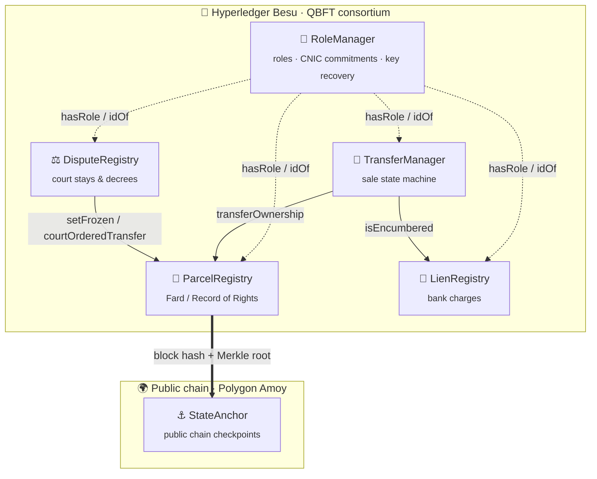
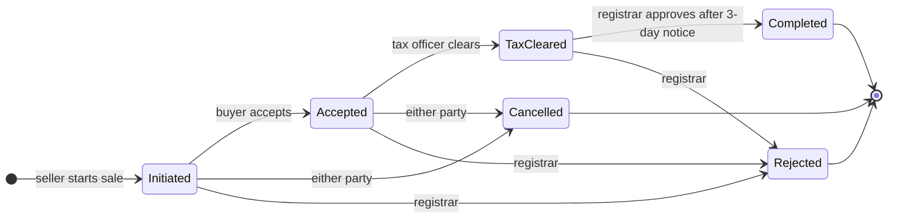

<div align="center">

# 🏛️ Blockchain Land Registry & Property Transfer

### A permissioned consortium-chain prototype for fraud-proof land records

*No more duplicate registrations · Transfers in days, not weeks · Instant ownership checks for banks*

<br/>


<br/>


<br/>


<br/>

[✨ Features](#-key-features) ·
[🏗️ Architecture](#%EF%B8%8F-architecture) ·
[🚀 Quick Start](#-quick-start) ·
[📊 Dashboard](#-web-dashboard) ·
[🌐 Deploying](#-deploying) ·
[📈 Results](#-measured-results) ·
[🛡️ Security](#%EF%B8%8F-static-analysis)

</div>

---

## 🎓 About the Project

> **Course:** CS-491 Blockchain Technologies and Applications — Complex Engineering Problem (CEP), Scenario A
> **Institution:** Mehran University of Engineering and Technology, Jamshoro

A provincial land revenue department wants three things:

| 🚫 Problem today | ✅ What this system does |
|---|---|
| Fraudulent duplicate registrations | Deterministic parcel keys — a duplicate registration **reverts on-chain** |
| Property transfers take weeks | A transparent sale state machine that finishes in **days** |
| Banks wait to verify ownership | `verifyOwnership` answers **instantly** |

This repository contains the smart-contract core of a **permissioned consortium chain (Hyperledger Besu, QBFT)**. Its state is periodically **anchored to a public chain** so outsiders can verify it.

### 👥 Team

<table>
  <tr>
    <td align="center"><b>👨‍💻 Muhammad Yahya</b><br/><code>22CS001</code></td>
    <td align="center"><b>👨‍💻 Shehzad</b><br/><code>22CS049</code></td>
    <td align="center"><b>👨‍💻 Muzzamil</b><br/><code>22CS073</code></td>
  </tr>
</table>

---

## ✨ Key Features

- 🔑 **Role-based access** — Registrar, Patwari, Bank, Court, Tax and KYC roles via OpenZeppelin `AccessControl`
- 🪪 **Private identity** — only a hashed CNIC commitment is stored, bound one-to-one to a wallet
- ♻️ **Key recovery** — lost wallets can be rebound after a 2-day objection window
- 👮 **Two-official registration** — a Patwari proposes, a *different* Registrar approves
- 🧾 **Sale workflow** — Initiated → Accepted → TaxCleared → 3-day public notice → Completed
- 🏦 **Bank liens** — a mortgaged parcel cannot be sold until the lien holder releases it
- ⚖️ **Court orders** — stays freeze a parcel; decrees append a corrective entry without erasing history
- ⚓ **Public anchoring** — Merkle roots of parcel state checkpointed to Polygon Amoy
- ⛽ **Zero-fee chain** — citizens never need cryptocurrency; gas only meters computation
- 📄 **Documents off-chain** — only hashes of the Fard, sale deed, tax receipt and decree go on-chain

---

## 🏗️ Architecture



### 📦 Smart Contracts

| Contract | Responsibility |
|---|---|
| 🔐 **`RoleManager`** | OpenZeppelin AccessControl roles (Registrar, Patwari, Bank, Court, Tax, KYC). One-to-one binding of a hashed CNIC commitment to a wallet. Key recovery with a 2-day objection delay. |
| 📜 **`ParcelRegistry`** | Deterministic parcel key `keccak256(district, mouza, khasra)`, so a duplicate registration reverts. Two-official registration (Patwari proposes, a different Registrar approves). Only modules can change owners. Emergency pause. Instant `verifyOwnership` for banks. |
| 🔄 **`TransferManager`** | Sale state machine: Initiated → Accepted → TaxCleared → (3-day public notice) → Completed / Cancelled / Rejected. One open transfer per parcel. Version pinning. |
| 🏦 **`LienRegistry`** | Owner consent plus a bank registers a mortgage. While a lien is active the parcel cannot be sold. Only the lien holder can release it. |
| ⚖️ **`DisputeRegistry`** | Court stay (freezes the parcel) and decree (appends a corrective ownership entry; history is preserved). |
| ⚓ **`StateAnchor`** | Deployed on a public chain (e.g., Polygon Amoy). Stores monotonic checkpoints of consortium state. |

### 🔄 Property Sale Lifecycle



> 📁 Only **hashes** of documents (scanned Fard, sale deed, tax receipt, decree) go on-chain. The files themselves live in the department's document store or a private IPFS cluster.

---

## 🧰 Prerequisites

| Tool | Version | Required? |
|---|---|---|
|  Node.js + npm | ≥ 18 (tested on v22) | ✅ Yes |
|  Python 3 + `slither-analyzer` | any | ⚪ Optional — static analysis |
|  Docker | any | ⚪ Optional — 4-node Besu network |

> 💡 The project compiles with the **bundled solc-js 0.8.24** (`npm` package `solc`), so it needs no compiler download and works offline or behind a university proxy. See `hardhat.config.js`.

---

## 🚀 Quick Start

```bash
# 1️⃣  Install dependencies
npm install --legacy-peer-deps

# 2️⃣  Compile the contracts
npm run compile

# 3️⃣  Run the test suite
npm test                 # 47 tests
npm run test:gas         # tests + per-function gas table
npm run coverage         # statement / branch coverage

# 4️⃣  Watch the end-to-end story
npm run demo             # the scenario used in the viva demo
```

---

## 📊 Web Dashboard

```bash
npx hardhat node          # terminal 1 (leave running)
npm run seed              # terminal 2: deploys + fills demo parcels, sales, liens, court cases
npm run dashboard         # then open http://localhost:3000
```

The dashboard shows:

- 📈 KPIs and the full parcel register
- 🔄 Sales in every state, liens and court cases
- 🕵️ The ownership audit trail
- 📍 Contract addresses and the latest public anchor
- 🏦 A **live bank ownership check** that calls `verifyOwnership`

> 🔒 Names and places come from an off-chain directory (`dashboard/data/seed.json`). The chain stores only commitments and hashes.

---

## 🌐 Deploying

<details>
<summary><b>1️⃣ Local Hardhat network</b> — used for the report's measurements</summary>

<br/>

```bash
npx hardhat node                      # terminal 1 (30M gas blocks, chainId 31337)
npm run deploy:local                  # terminal 2 -> deployments/localhost.json
npm run benchmark                     # -> reports/benchmark.json
```
</details>

<details>
<summary><b>2️⃣ Hyperledger Besu QBFT consortium</b> — 4 validators</summary>

<br/>

```bash
cd besu-network
docker run --rm -v $PWD:/data hyperledger/besu:24.12.2 operator generate-blockchain-config \
  --config-file=/data/qbftConfigFile.json --to=/data/networkFiles --private-key-file-name=key
# copy networkFiles/genesis.json -> ./genesis.json and each keys/<addr>/key -> node1..node4/
docker compose up -d
cd ..
DEPLOYER_KEY=0x... npx hardhat run scripts/deploy.js --network besu
```

> ⛽ The genesis file uses `zeroBaseFee` and `--min-gas-price=0`, so citizens never need cryptocurrency: gas only meters computation.
</details>

<details>
<summary><b>3️⃣ Public anchor on Polygon Amoy</b> — optional</summary>

<br/>

```bash
DEPLOYER_KEY=0x... AMOY_RPC=https://... npx hardhat run scripts/deploy.js --network amoy
```

> Only `StateAnchor` is meaningful on the public chain.
</details>

---

## 📈 Measured Results

<sub>Local Hardhat node, 30M block gas limit</sub>

| ⚙️ Operation | ⛽ Gas |
|---|---:|
| `verifyCitizen` | 93,873 |
| `proposeParcel` + `approveParcel` | 123,631 + 61,504 = **185,135** |
| Complete sale (initiate + accept + clearTax + approve) | **380,763** |
| `registerLien` / `releaseLien` | 171,134 / 33,355 |
| `openCase` / `resolveCase` (with decree) | 178,985 / 69,563 |
| Full system deployment | 5,552,680 |

<table>
  <tr>
    <td align="center">⚡<br/><b>120–130 tx/s</b><br/><sub>sequential, 200 tx</sub></td>
    <td align="center">⏱️<br/><b>p50 ≈ 5 ms · p95 ≈ 10 ms</b><br/><sub>latency, single node</sub></td>
    <td align="center">📦<br/><b>242 tx / block</b><br/><sub><code>proposeParcel</code> per 30M gas</sub></td>
    <td align="center">🏁<br/><b>≈ 3.4 M sales / day</b><br/><sub>Besu QBFT, 2 s blocks</sub></td>
  </tr>
</table>

- 📦 Block packing of 242 `proposeParcel` tx per block matches 30,000,000 / 123,631.
- 🔮 Besu QBFT projection at a 2 s block period: about **121 registrations/s**, or about **39 complete sales/s**.

### 🧪 Test Coverage

| File | % Stmts | % Branch | % Funcs | % Lines |
|---|---:|---:|---:|---:|
| `DisputeRegistry.sol` | 93.75 | 83.33 | 80 | 96 |
| `LienRegistry.sol` | 93.33 | 75 | 83.33 | 95.83 |
| `ParcelRegistry.sol` | 100 | 71.43 | 100 | 100 |
| `RoleManager.sol` | 93.33 | 66.67 | 90 | 95 |
| `StateAnchor.sol` | 85.71 | 100 | 80 | 85.71 |
| `TransferManager.sol` | 100 | 88 | 100 | 100 |
| **All files** | **96.55** | **76.77** | **92.73** | **97.61** |

> 📂 Full outputs live in [`reports/`](reports/): `gas-report.txt`, `benchmark.json`, `coverage-summary.txt`, `slither-*.txt`, `demo-output.txt`.

---

## 🛡️ Static Analysis

```bash
npm run slither
```

Slither 0.11.6 ran **102 detectors** and reported **4 findings, 1 of which was fixed** (an unindexed event address).

The other 3 are `block.timestamp` comparisons, which are accepted: the delays last days, and QBFT validators are known institutions, so the few seconds of timestamp drift a validator could introduce do not matter. See report §4.3.

---

## 🗂️ Repository Layout

```text
📦 land-registry-dapp
 ┣ 📂 contracts/       6 Solidity contracts
 ┣ 📂 test/            47 Mocha/Chai tests (fixture.js holds the shared deployment)
 ┣ 📂 scripts/         deploy.js, demo.js, benchmark.js, seed.js
 ┣ 📂 dashboard/       web dashboard (server.js, index.html, app.js, style.css)
 ┣ 📂 besu-network/    QBFT genesis config + docker-compose for 4 validators
 ┣ 📂 reports/         gas, coverage, slither, benchmark, demo outputs
 ┗ 📂 deployments/     addresses written by deploy.js
```

---

## ⚠️ Limitations (Prototype)

- 🪪 Identity commitments are created by a trusted KYC role. There is no live NADRA integration.
- 🖥️ The dashboard is read-only (apart from the bank ownership check). Writes go through scripts, tests, or any EVM wallet/console.
- 🔧 Contracts are not upgradeable by design. Governance replaces modules through `setModules` and then locks them, so a new version means a redeploy plus a migration (see report §5.4).
- 🚧 This code is **not production-audited**.

---

<div align="center">

## 📜 License

Released under the **MIT License**.

<br/>

Made with ❤️ at **Mehran University of Engineering and Technology, Jamshoro**

⭐ *If you find this project useful, consider giving it a star!*

</div>
